# ECA-VGG16 Transfer Fault Diagnosis, with MATLAB Code

This program requires the use of MATLAB version 2024 to run! The installation package is included in the attachment.

Overview:
Currently, there are many codes for ECA attention mechanism based on PyTorch online, which increases the learning barrier for those who are accustomed to using MATLAB. In this session, Xiao Tao has implemented the ECA attention mechanism using MATLAB code and integrated it into the classic VGG16 network. It was validated on the Case Western Reserve University bearing data and underwent transfer learning under different working conditions. The results were extremely good!
ECA (Efficient Channel Attention) attention mechanism is an improved version of SENET, removing the fully connected layers in the original SENET and replacing them with 1x1 convolution kernels. This makes the model parameters smaller and lighter, as ECA's author believes that convolutions have good cross-channel information capture capabilities, so capturing all channel information is unnecessary, hence the removal of fully connected layers and the replacement with 1x1 convolutions.
Here, I also briefly discuss my understanding of the ECA mechanism. My way of thinking is simple, just like this! If you have any doubts, please correct me, and my understanding here only represents my personal viewpoint (do not criticize!).
In a previous article, I had implemented the SE attention mechanism using MATLAB language because ECA is an improvement of SE. Therefore, I will mention the SE mechanism again.
The SE attention mechanism first aggregates the information from each feature channel through global average pooling, which can be seen as compressing the entire image information into a small statistical data. Then, the SE mechanism inputs these aggregated information successively into a fully connected layer + a ReLU linear activation layer + a fully connected layer + Sigmoid function. Moreover, the two fully connected layers are processed through dimensionality reduction and elevation before being combined with the ReLU linear activation layer and Sigmoid function. This not only ensures the simplification of training parameters but also increases training speed and calculates the importance of each channel. The result map of the SE mechanism is as follows:
SE mechanism paper: https://arxiv.org/abs/1709.01507
\n        \n  
The ECA attention mechanism shares the same approach as SE in that it first employs a global average pooling layer to compress the entire image information. Subsequently, it utilizes a local convolution to capture channel-wise dependencies rather than performing global operations, which significantly reduces computational load while preserving the effectiveness of the attention mechanism. Finally, ECA adjusts features based on computed channel importance, enhancing the weight of important features and suppressing less significant ones, thereby enhancing the overall performance of the model. The result of the ECA mechanism is illustrated below:
\n        \n  
ECA mechanism paper download link: https://arxiv.org/pdf/1910.03151.pdf
After understanding the ECA mechanism, it's time to move on to coding. Undeniably, coding this attention mechanism is filled with numerous pitfalls! It's almost like I've been working my fingers to the bone.
ECA-VGG16 Model Introduction
VGGNet has achieved the honor of being ranked second in ImageNet image classification in 2014, among which VGG16 is one of the best-performing networks in VGGNet, as shown in the network structure diagram.
\n        \n  
The ECA-VGG16 model structure introduced in this issue is referenced as follows:
\n        \n  
In this issue, the following improvements have been made to the VGG16 network: Each convolutional layer in the first five segments is equipped with an ECA (Enhanced Convolutional Attention) module, a BN (Batch Normalization) layer, and a ReLU activation function. The ECA unit is used to learn the importance of each channel, thereby enhancing useful features and suppressing irrelevant ones. The BN layer (batch normalization) serves to accelerate the training and convergence speed of the network, preventing gradient explosion and vanishing gradients, making the model more stable; the ReLU activation function enhances the network's nonlinearity, prevents gradient vanishing, reduces overfitting, and improves the speed of network training. To prevent overfitting, dropout is added after both FC layers in the sixth segment. Softmax is used for final classification, as the bearing dataset has 10 states, so the final output is 10.
\n        \n  
Experimental results display
First, let's discuss the experimental results: all experiments were conducted with 900 samples for training and 300 samples for testing.
Standard VGG16, in the condition of 0, the accuracy of diagnosis is: 98.667%
\n        \n  
The VGG16 with ECA mechanism, under condition 0, has a diagnostic accuracy of 100%.
\n        \n  
When migrating the model from Condition 0 to Condition 1, only a small sample (20 samples per fault type) is used for fine-tuning the fully connected layer, while other layers are frozen. The training speed is significantly improved, with a diagnostic accuracy of 99.9% on the test set (1000 samples).
\n        \n  
When migrating the model from condition 0 to condition 2, only a small sample (10 samples for each fault) is used for fine-tuning the fully connected layer, while other layers are frozen. The training speed is significantly improved, and the diagnostic accuracy on the test set (1100 samples) is 99.5%.
\n        \n  
When migrating the model from condition 0 to condition 3, only a small sample (10 samples for each fault) is used for fine-tuning the fully connected layer, while other layers are frozen. The training speed is significantly improved, and the diagnostic accuracy on the test set (1100 samples) is 99.6%.
\n        \n  
Experimental process: Implementing transfer learning for bearing fault diagnosis based on ECA-VGG16 model under different working conditions
The experimental steps are as follows:
Step 1: Process data from Xiuyun University under different working conditions. Details of the Xiuyun University data are as follows:
The motor load in the second column is divided into four operating conditions: 0, 1, 2, and 3. Here, only the four operating conditions corresponding to a fault diameter of 0.1778, 0.3556, and 0.5334 mm are considered. The data for these four operating conditions will be processed as follows.
Partial overlap sampling method is adopted, where samples are collected from the original signal, with partial overlap between adjacent sample points. The raw time-domain signal is divided into 2048 data points to form a sample. To ensure that every data point can be captured, there will be 1048 overlapping data points between adjacent samples, with a sliding window step size of 1000. Each working condition contains 10 types of faults, each type consisting of 120 samples.
The screenshot of the first step's code organization is as follows, and finally obtained Working condition0.mat, Working condition1.mat, Working condition2.mat, Working condition3.mat, which respectively represent working conditions 0, 1, 2, 3.
\n        \n  
Step 2: Continuous wavelet transform of the first step data:
The data from the four different working conditions obtained in the first step is synchronized with wavelet transformation. The extracted images are placed in the corresponding "Working Condition X Continuous Wavelet Transform Video Images" folder, and then the images are compressed. The purpose of compression is to save time for subsequent model training. The code screenshot is as follows:
\n        \n  
Step Three: Model Training and Transfer Learning under Different Working Conditions.
Firstly, the ECA-VGG16 network is used to train and test data from condition 0. For each group of faults, the first 90 samples are selected for training, and the last 30 samples are tested, achieving a 100% accuracy rate.
The distribution plots before and after dimensionality reduction with ECA-VGG16-TSNE are as follows:
\n        \n  
Transfer Learning: Subsequently, the basic unit modules and ECA modules trained in condition 0 are frozen. Using small sample data (20 sets per fault type) from conditions 1, 2, and 3, the fully connected layers of the model are fine-tuned. The remaining 1000 samples (100 sets per fault type) are then tested.
Screenshot of the code directory for Step Three is as follows:
\n        \n

## Images

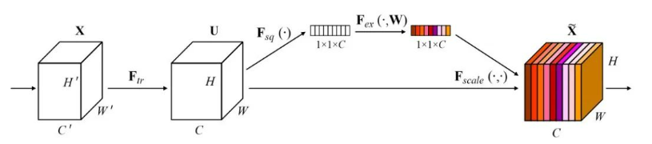
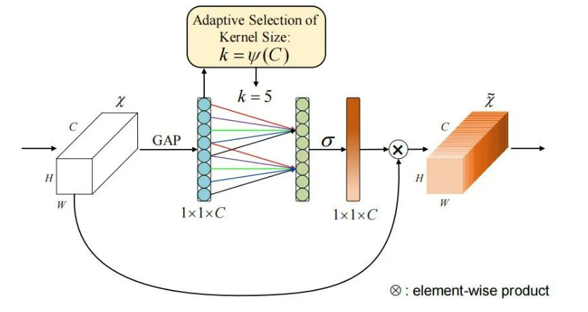
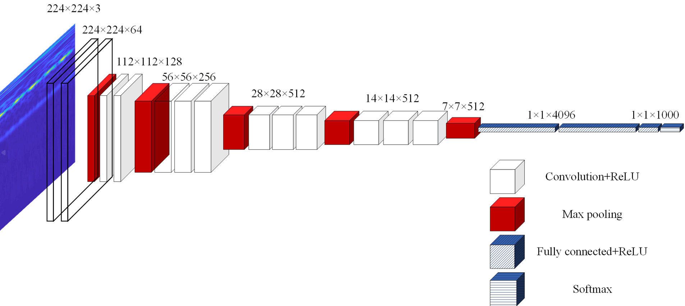
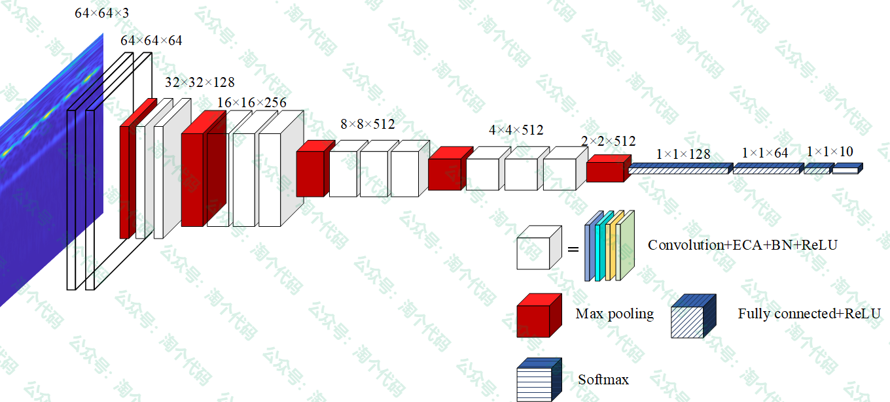
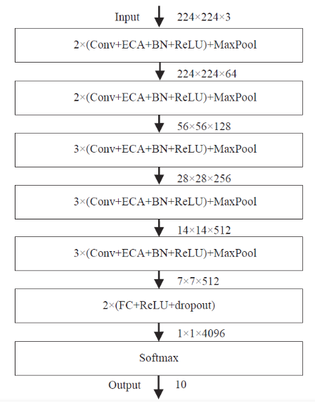
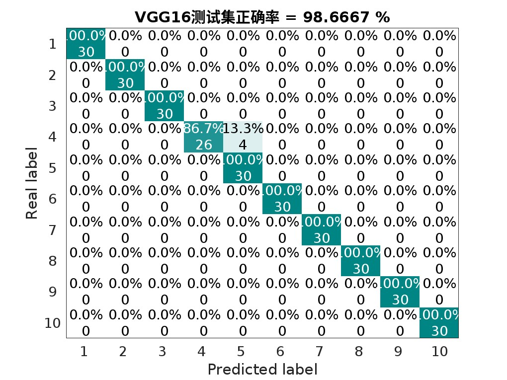
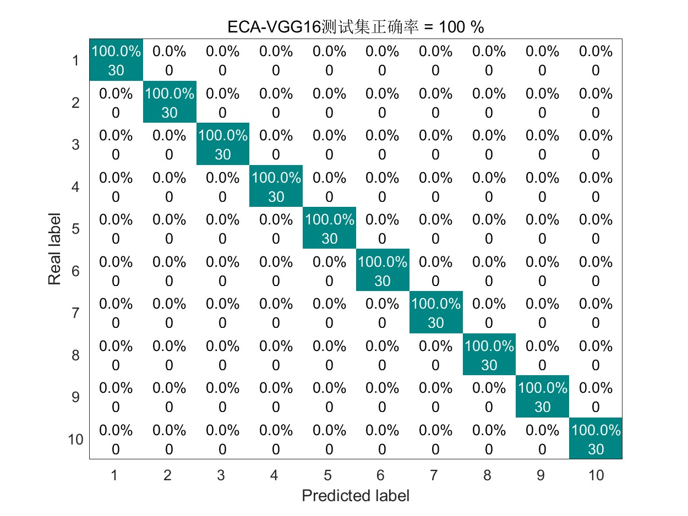
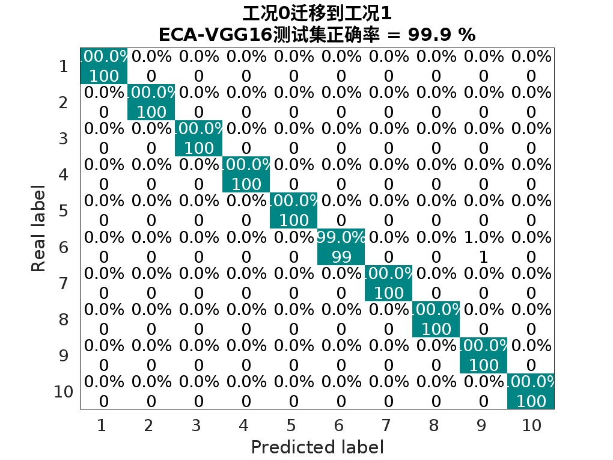
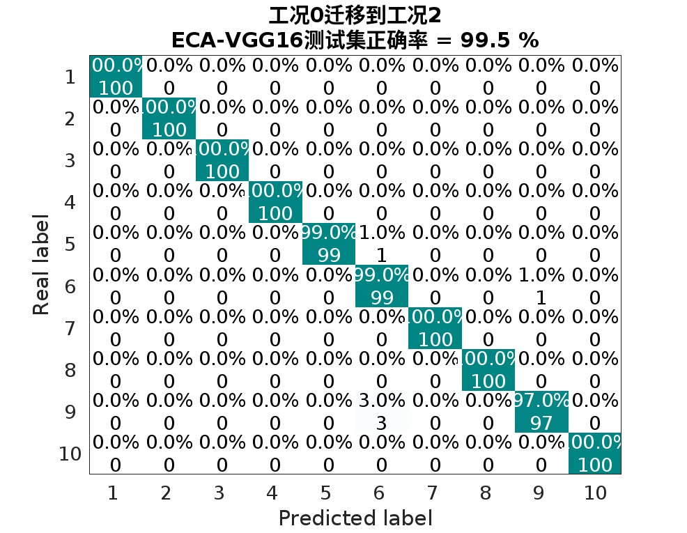
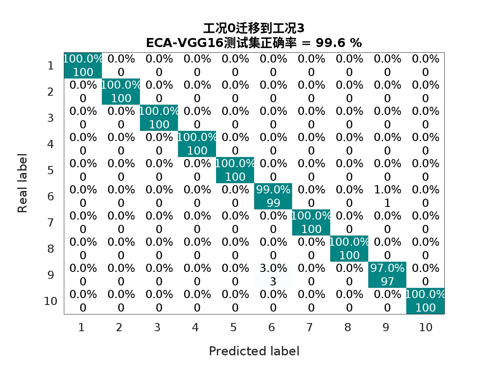
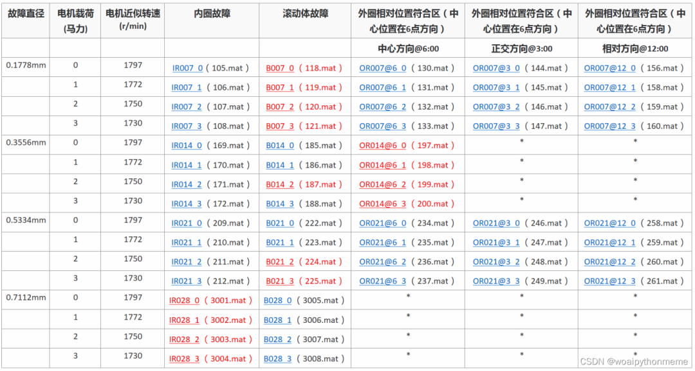
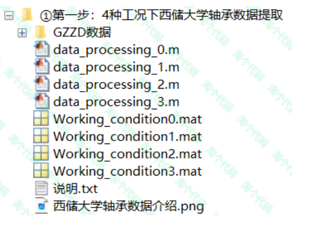
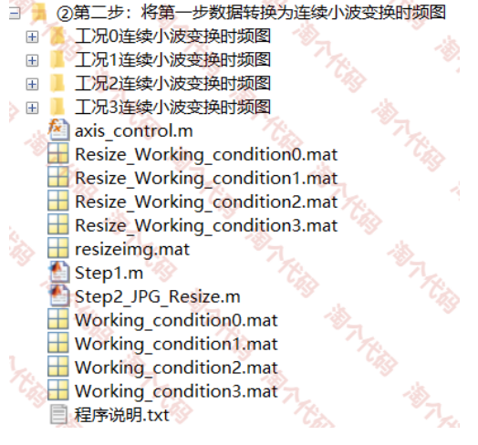
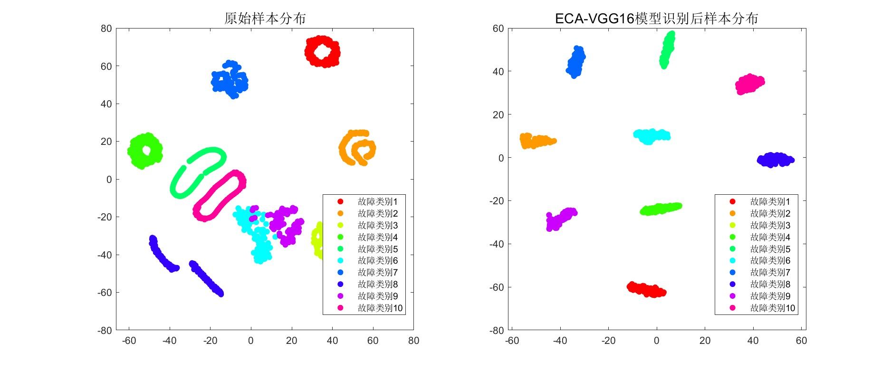
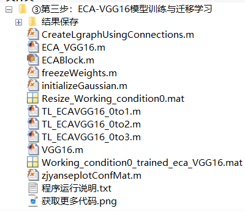

<!-- PAYMENT_BLOCK -->

## Get this dataset

- Payment link (Stripe): [Buy now](https://buy.stripe.com/3cs8yP7sY87d0vu9AB)
- Payment QR code: 

<!-- /PAYMENT_BLOCK -->
